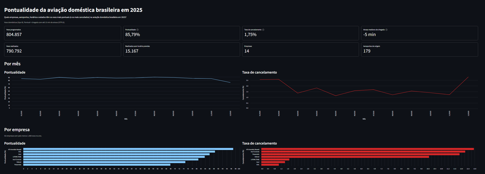

# Pontualidade da aviação doméstica brasileira em 2025

[](https://github.com/GabrielItaqui/anac-pipeline/actions/workflows/ci.yml)

Pipeline de dados em três camadas (raw → refined → marts) com dados abertos da ANAC,
construído com Python 3.13, uv e DuckDB. Desafio final do curso Pipeline Olist.

**Pergunta de negócio:** quais empresas, aeroportos, horários e estados têm os voos
mais pontuais (e os mais cancelados) na aviação doméstica brasileira em 2025?

## Resultados

Voos domésticos (tipo `N`) de 2025. Pontual = chegada com até 15 min de atraso (OTP15).
Rankings por empresa só com empresas de pelo menos 1.000 voos no ano.

- **Ano:** 804.857 voos programados e 790.792 realizados. **85,79%** dos 775.625 voos
  avaliados chegaram no horário. **1,75%** foram cancelados (14.065). O atraso mediano de
  chegada é **−5 min**: o voo típico chega 5 minutos antes do previsto.
- **Pontualidade por empresa:** ATA Aerotáxi Abaeté 96,92%, GOL 88,51%, Azul 86,02%,
  LATAM (TAM) 83,78%, Azul Conecta 80,84%, Sideral 74,83% e Passaredo 67,90%.
- **Cancelamento por empresa:** ATA Aerotáxi Abaeté 12,75%, Azul Conecta 12,23%,
  Passaredo 11,89%, Sideral 10,06%, LATAM (TAM) 1,68%, Azul 1,42% e GOL 1,05%.
  As grandes cancelam menos de 2%; as regionais, mais de 10%. A ATA é ao mesmo tempo a
  mais pontual e a que mais cancela.
- **Rotas mais voadas:** Congonhas → Santos Dumont (18.169 voos, 88,40% pontual),
  Santos Dumont → Congonhas (18.163, 90,14%) e Congonhas → Brasília (8.910, 83,55%).
- **Estados:** os mais pontuais são Tocantins (93,68%), Acre (91,23%) e Piauí (90,01%).
  Os menos pontuais são São Paulo (82,99%), Rondônia (83,10%) e Minas Gerais (84,48%).
  São Paulo é a origem de um terço dos voos programados (263.054).
- **Ao longo do dia:** a pontualidade cai conforme o dia avança. A melhor hora de partida
  é 5h (93,77%) e a pior, 19h (80,95%). Das 4h às 6h fica acima de 93%; das 17h às 19h,
  perto de 81%.
- **Mês:** dezembro foi o pior mês, com 74,21% de pontualidade e 2,80% de cancelamento.

## Fonte dos dados

| Tabela | Origem | Formato |
|---|---|---|
| VRA – Voo Regular Ativo (jan–dez/2025) | https://siros.anac.gov.br/siros/registros/diversos/vra/2025/ | 12 CSVs mensais (~316 MB) |
| Lista de aeródromos públicos | https://sistemas.anac.gov.br/dadosabertos/Aerodromos/Aer%C3%B3dromos%20P%C3%BAblicos/Lista%20de%20aer%C3%B3dromos%20p%C3%BAblicos/AerodromosPublicos.csv | 1 CSV |

- **Licença:** dados públicos publicados pela ANAC no âmbito da Política de Dados Abertos
  do Poder Executivo federal (Decreto nº 8.777/2016). A ANAC descreve seus dados abertos
  como livres de licença; não há licença Creative Commons específica no portal do VRA.
  A fonte é sempre citada.
- **Tipo de ingestão:** download batch via HTTP de arquivos publicados (não é uma API).
  Os dados **não são versionados** no repositório; são reproduzidos a partir da fonte
  oficial a cada execução.
- **A fonte muda depois de publicada:** o arquivo de jan/2025 foi republicado pela ANAC
  em 22/10/2026. Por isso a ingestão registra um manifesto com o SHA-256 de cada arquivo.

## O que é uma linha de cada tabela

- **VRA:** um voo (uma etapa de origem para destino) programado ou realizado, com
  horários previstos e reais. Chave natural: empresa + número do voo + aeroporto de
  origem + partida prevista.
- **Aeródromos:** um aeródromo público cadastrado na ANAC. Chave: `Código OACI`
  (496 linhas, 496 códigos únicos).
- **Ligação:** `VRA.Sigla ICAO Aeroporto Origem = Aeródromos.Código OACI` (LEFT JOIN).

## Camadas

| Camada | O que faz | Regra |
|---|---|---|
| raw | CSV carregado como está, todas as colunas em VARCHAR, mais `_arquivo_origem` e `_carregado_em` | Nunca é alterada |
| refined | Tipagem, conversão de datas, deduplicação, cálculo de atraso, flags | Só lê a raw |
| qualidade | Checks de dados que rodam antes dos marts e param o pipeline se falharem | Separada dos testes unitários |
| marts | Um `.sql` por indicador, com o grão na primeira linha | Só lê a refined |

Carga validada por contagem independente: 1.005.807 linhas no VRA 2025, iguais
arquivo a arquivo à contagem direta das quebras de linha dos CSVs.

## Indicadores (marts)

Cada mart vira a tabela `marts.<nome>` e considera só voos tipo `N`. Os rankings por
empresa e por aeroporto exigem pelo menos 1.000 voos no ano.

| Mart | Grão (uma linha = ...) |
|---|---|
| [01_voos_mensais](sql/marts/01_voos_mensais.sql) | um mês de 2025 (`Referência`) |
| [02_pontualidade_por_empresa](sql/marts/02_pontualidade_por_empresa.sql) | uma empresa aérea |
| [03_cancelamento_por_empresa](sql/marts/03_cancelamento_por_empresa.sql) | uma empresa aérea |
| [04_atraso_por_aeroporto](sql/marts/04_atraso_por_aeroporto.sql) | um aeroporto de origem |
| [05_rotas_mais_voadas](sql/marts/05_rotas_mais_voadas.sql) | um par origem-destino (A→B e B→A são rotas diferentes; top 20) |
| [06_pontualidade_por_hora](sql/marts/06_pontualidade_por_hora.sql) | uma hora do dia (0–23) da partida prevista |
| [07_pontualidade_por_uf](sql/marts/07_pontualidade_por_uf.sql) | uma UF de origem (usa o JOIN com aeródromos) |
| [08_kpis](sql/marts/08_kpis.sql) | o ano de 2025 inteiro (uma linha só) |

## Definições e decisões

Números medidos no arquivo de jan/2025 (89.616 linhas), exceto onde a linha indica o
ano inteiro.

| Decisão | Motivo |
|---|---|
| **Voo pontual = chegada com até 15 min de atraso (OTP15)** | Padrão internacional de pontualidade |
| Cancelados ficam fora do denominador da pontualidade | Voo que não voou não pode chegar atrasado |
| Realizados sem horário previsto (2.253, 2,6%) ficam fora da pontualidade e são contados à parte em `voos_sem_previsao` | Sem horário previsto não há atraso calculável. A própria ANAC também não os classifica |
| Pontualidade calculada só para voos tipo `N` (doméstico); a refined guarda todos os tipos | Escopo da pergunta. O JOIN com aeródromos cobre 99,7% dos voos N, contra cerca de metade nos internacionais |
| Voos sem tipo de linha ficam fora dos marts | No ano inteiro, 463 linhas da raw (0,05%) vêm com `Código Tipo Linha` vazio. Sem o tipo não dá para saber se são domésticas, e o escopo dos marts é tipo `N` |
| Mês do voo = coluna `Referência` | É a atribuição da própria ANAC, nunca vem vazia e resolve os 21 voos que vazam para fevereiro |
| Horários tratados como horário de Brasília, inclusive em aeroportos estrangeiros | Evidência: Miami → Galeão 01:10 → 09:25 só dá a duração real da rota (~8h) se os dois horários estiverem no mesmo fuso |
| Raw toda em VARCHAR | `Número Voo` tem zero à esquerda (`0904`); ler como número apagaria o zero |
| Leitura com `quote=''` e `escape=''` | Nenhum arquivo usa aspas como delimitador; as aspas existentes são parte do dado (ex.: 09°52'06"S). Fixado no código para não depender da detecção automática |
| Antes da carga, toda linha de dados de cada arquivo (VRA e aeródromos) precisa ter o mesmo número de `;` que o cabeçalho; senão a carga para com arquivo, linha e contagens | O DuckDB tolera um `;` sobrando no fim da linha: como toda linha do VRA termina em `;` (Codeshare vazio), uma linha com um campo a mais entrava com as colunas deslocadas, sem erro. Com `quote=''` todo `;` é separador, então a contagem é exata |
| `_carregado_em` em UTC | É metadado técnico da carga, igual ao manifesto; a regra "horário de Brasília" vale só para os horários dos voos |
| Deduplicação por empresa + voo + origem + partida prevista, só para voos com previsão | No ano inteiro há 59 chaves duplicadas, todas dentro do mesmo arquivo. O desempate é determinístico: arquivo de origem, depois partida real e chegada real mais cedo (vazio por último) e, por fim, a `Referência` mais cedo (uma duplicata só difere no dia da `Referência`). Aplicar a chave nos voos sem previsão apagaria voos reais diferentes |
| Aeródromos sem cadastro aparecem como UF "Não cadastrado" | 5 aeródromos (provavelmente privados) somam 206 voos N (0,29%). LEFT JOIN para não perder voos |
| Check de qualidade reconcilia nosso cálculo com a coluna `Situação Chegada` da ANAC (tolerância de 30 min) | A ANAC classifica com 30 min. Bater com ela prova que o cálculo de atraso está correto. Regra: Antecipado/Pontual = atraso ≤ 30 min. Medido em 949.842 voos: ≤ 30 concorda em 99,98% (202 divergências, todas "Pontual" com 31 min, provavelmente porque a ANAC calcula com segundos, que não existem no arquivo público); < 30 concorda em 99,64%. O check falha abaixo de 99,9% |
| Atraso típico = mediana, não média | Há atrasos extremos, até 44.625 min (provavelmente erros de registro), que distorcem a média. A pontualidade não é afetada porque é sim/não |
| Cancelamento por empresa, não por justificativa | A coluna `Justificativa` vem 100% vazia, inclusive nos cancelados |

## Como rodar do zero

Pré-requisitos: [git](https://git-scm.com/) e [uv](https://docs.astral.sh/uv/). O uv lê o
`.python-version` e instala o Python 3.13 sozinho.

```powershell
git clone https://github.com/GabrielItaqui/anac-pipeline.git
cd anac-pipeline
uv sync
uv run python -m pipeline.ingestao
uv run python -m pipeline.transformacao
uv run python -m pipeline.marts
uv run pytest --cov=pipeline
```

- `pipeline.ingestao` baixa 13 arquivos (~316 MB) para `data/raw/` e carrega a raw. Levou
  cerca de 2 min; o tempo depende da conexão com os servidores da ANAC. Rodar de novo não
  baixa outra vez o que já bate com o manifesto.
- `pipeline.transformacao` cria a refined (poucos segundos).
- `pipeline.marts` roda os checks de qualidade antes e só cria os marts se todos passarem.
  Para ver o resultado de cada check: `uv run python -m pipeline.qualidade`.
- No fim, `data/` ocupa cerca de 450 MB (CSVs + `data/anac.duckdb`, ~140 MB).

Procedimento validado num clone limpo em 30/10/2026: todos os comandos acima rodaram sem
erro, e os 8 marts saíram idênticos, linha a linha, aos do banco de desenvolvimento.

## Testes

- 68 testes unitários com pytest (4 deles do dashboard), cobertura de 78% do pacote
  `pipeline`.
- Usam só dados inventados pequenos: os bancos são criados em memória (`:memory:`) e os
  arquivos em `tmp_path`. Nenhum teste abre o `data/anac.duckdb`.
- Nenhum teste usa a rede: o [conftest.py](tests/conftest.py) faz qualquer acesso via
  `urllib` falhar.
- A [CI](.github/workflows/ci.yml) roda os testes no GitHub Actions a cada push e pull
  request na `main` e falha se a cobertura ficar abaixo de 60%.

## Dashboard (opcional)

Painel Streamlit sobre os marts, em [dashboard/app.py](dashboard/app.py). Depois de rodar
o pipeline:

```powershell
uv run --group dashboard streamlit run dashboard/app.py
```

**Regra:** o dashboard lê só do schema `marts` e não calcula nada na tela (sem soma,
média ou percentual em Python); só ordena, renomeia e formata. Toda regra de negócio fica
nos `.sql` dos marts, que são testados e versionados. O
[test_dashboard.py](tests/test_dashboard.py) confere isso no código-fonte do app: toda
consulta lê de `marts.`, sem `refined.` nem `raw.`.



## Estrutura do repositório

```
pipeline/        um módulo por etapa: ingestao, transformacao, qualidade, marts
                 (+ config.py com URLs e caminhos, db.py com a conexão)
sql/refined/     transformações da refined (voos, aeródromos)
sql/qualidade/   checks de dados, um por arquivo
sql/marts/       um .sql por indicador, com o grão na primeira linha
tests/           testes unitários com dados inventados
dashboard/       painel Streamlit opcional, lendo só os marts
docs/            print do dashboard
.github/         CI (GitHub Actions)
data/            gerado em runtime, fora do git (CSVs, manifesto, anac.duckdb)
```

## Onde a IA errou ou assumiu algo (e como descobrimos)

O projeto foi feito com o Claude Code. As regras fixas (formatos reais dos arquivos,
regras de cada camada, testes, git) ficaram no [CLAUDE.md](CLAUDE.md), e cada etapa teve
uma spec própria. Antes de codar, a IA listava as premissas que estava assumindo, e cada
uma foi conferida contra os dados reais. A tabela registra o que estava errado.

| # | O que a IA assumiu | O que era verdade | Como foi descoberto |
|---|---|---|---|
| 1 | O VRA começa com uma linha `Atualizado em:` e o cabeçalho está na linha 2 | No arquivo do SIROS o cabeçalho está na linha 1 (a premissa vinha de outro portal da ANAC) | Lendo os bytes crus com `Get-Content` antes de escrever qualquer parser |
| 2 | Horários ausentes vêm como o texto literal `null` | Vêm como campo vazio (0 ocorrências do texto `null`) | Consulta contando vazios × texto `null` por coluna |
| 3 | Existe uma coluna de justificativa preenchida para os cancelamentos | `Justificativa` vem 100% vazia | Consulta agrupando por justificativa; o mart 03 foi redesenhado |
| 4 | Filtrar `LIKE 'S%'` isola aeroportos brasileiros | Toda a América do Sul começa com S (SC = Chile, SA = Argentina...) | Lendo a descrição dos aeroportos no resultado |
| 5 | A spec pedia "3 tentativas" com três esperas (2 s → 4 s → 8 s) | Três tentativas no total só têm duas esperas; a spec era internamente contraditória | O Claude Code apontou a ambiguidade na lista de premissas e implementou 1 tentativa + 3 novas |
| 6 | No script de verificação da Etapa 2, o Claude Code usou `con.sql(...).fetchone()`, API de versões antigas do DuckDB | No DuckDB 2.0 as relations não têm mais `fetchone()`; é preciso usar `con.execute(...).fetchone()` | O script falhou com `AttributeError` na primeira execução; o código do pipeline já usava `execute` e não foi afetado |
| 7 | Na Etapa 2, a IA testou um único tipo de linha malformada e concluiu que toda linha malformada derrubava a carga | Uma linha com um campo a mais e Codeshare vazio entrava com as colunas deslocadas, sem erro | Teste da Etapa 3 com um campo a mais no meio da linha; corrigido com a conferência do número de `;` por linha |
| 8 | O plano afirmava zero duplicatas pela chave de deduplicação, com base só em janeiro | A refined do ano inteiro mostrou 59 chaves duplicadas, e o desempate por arquivo não decidia nada porque as duplicatas estão no mesmo arquivo | Contagem de chaves duplicadas na refined do ano inteiro; corrigido com desempate por partida real e chegada real (vazio por último) e, por fim, `Referência` (uma duplicata só difere no dia da `Referência`) |